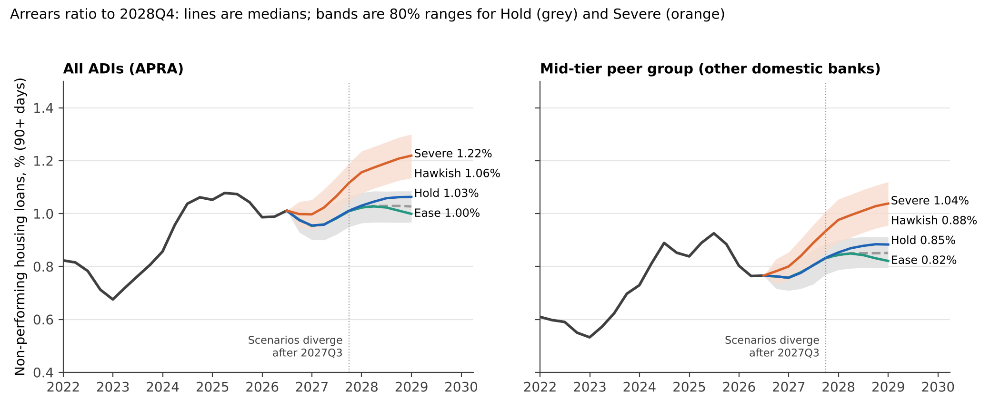

# Australian mortgage stress test: the 2026 RBA hiking cycle and what a mid-tier lender should do

Decision paper for a Head of Credit Risk, built on real RBA and APRA data (to June 2026, plus the 30 September 2026 cash-rate decision). The lender is hypothetical; the market data are real.

**Report:** [`docs/AU_mortgage_stress_test_report.pdf`](docs/AU_mortgage_stress_test_report.pdf) (13 pages) · **Author:** Thai Anh Lai · November 2026



## Questions
1. How much of the 2026 rate increases have reached household budgets?
2. How do mortgage arrears respond to the interest burden, and does that relationship hold up out of sample?
3. What happens to arrears, provisions and hardship workload under four rate scenarios to end-2028?
4. What should a mid-tier lender do: tighten, price, staff, or watch?

## Main results
- Cash rate 3.60% to 4.60% in 2026 (four increases); pass-through to discounted variable rates about 0.87. Interest burden about 9.5% of household income after the September increase (peak 9.9% in 2023Q4, low 8.0% in 2025Q3).
- Arrears (90+ days, all ADIs) are 1.01% and follow the burden with a lag of about five quarters (correlation 0.96). Out of sample the burden model is 38% more accurate than "no change" four quarters ahead and closer in 7 of 7 such forecasts (sign test p = 0.008, but the forecasts overlap and come from one cycle); at one quarter ahead it is a coin flip (5 of 10). It anticipated the 2025 turning point when fitted only to data to 2024Q4. The relationship survives in quarterly and four-quarter changes, and a residual Dickey-Fuller test gives weak support for a long-run link (t = -3.52).
- Scenarios to 2028Q4: arrears 1.03% (hold at 4.60%), 1.06% (5.10%), 1.22% (5.60% with unemployment rising to 6%). Until 2027Q3 every scenario is identical because arrears depend on burdens already in the data.
- Hypothetical $60bn lender: extra provisions about $15m to $35m at 20% loss given default, 15% to 20% more if 30-89 day loans are treated as AASB 9 stage 2; under AASB 9 the provisions arrive early (2026) even though arrears arrive late (2027-28). 2 to 6 extra hardship officers. Risk is concentrated above 80% LVR (non-performing 2.0% at 80-90%, 5.9% at 95%+), and new-lending standards have drifted looser over the past year.
- Independent check: the RBA's October 2026 Financial Stability Review (loan-level data) finds about 2% of variable-rate owner-occupiers in cash-flow shortfall, median buffers above a year of repayments, and about 5% at higher risk of default in a very adverse scenario, consistent with a modest, labour-market-driven rise.
- Lenders mortgage insurance cuts the lender's own premium at 80-90% LVR from about 17bp to about 5bp (assumed 80% insured), so risk-based pricing belongs on uninsured high-LVR loans.
- Recommendation: no across-the-board tightening; hold standards at last year's level, price the uninsured high-LVR segment, staff hardship ahead of late 2027, and watch six triggers.

## Repository structure
```
data/        RBA and APRA source files as downloaded, tidy panels built from them, SOURCES.md
src/         numbered pipeline steps; each reads data/ or outputs/ and writes outputs/
outputs/     every figure, table and statistic used in the report (CSV, JSON, PNG)
docs/        the report (DOCX and PDF), built from outputs/ by 05_build_report.py
run_all.sh   reproduces everything from data/ in one command
```

## Method in brief
- `01_prepare.py` parses RBA and APRA files into quarterly panels.
- `02_burden_and_cycles.py` distributed-lag pass-through regression, interest-burden construction.
- `03_arrears_model.py` lead-lag evidence, Newey-West fit, rolling-origin out-of-sample test against naive, AR(1) and burden+last-value models, turning-point test, robustness, lender-group fits, block bootstrap of parameters.
- `04_scenarios.py` four cash-rate scenarios, 4,000-draw Monte Carlo (lag 4/5/6, parameter, pass-through and AR(1) residual uncertainty), hypothetical-lender provisions and hardship load, LVR risk pricing, tornado sensitivity, reverse stress test, early-warning triggers.
- `05_build_report.py` builds the report from the saved outputs, so numbers in the text match the analysis.

## Reproduce
```
python -m venv .venv && source .venv/bin/activate
pip install -r requirements.txt
bash run_all.sh          # about two minutes (4,000-draw Monte Carlo per scenario)
```
Every number in the report is written by code from `outputs/`, so text and analysis cannot drift apart.
Key outputs: `docs/AU_mortgage_stress_test_report.docx` (and PDF), `outputs/*.png`, `outputs/scenario_*.csv`, `outputs/*_stats.json`.

## Data
See `data/SOURCES.md`. Real: RBA A2, E2, F5; APRA property exposures June 2026; BIS and OECD via FRED. Assumed: lender size, average loan, loss given default, time in default, cases per officer.

## Limits
19 post-COVID quarters and one hiking cycle; residual autocorrelation; unemployment effect weakly identified; scenarios extrapolate beyond the sample's maximum burden; system averages are not a lender's own experience; no loan-level data (the RBA's loan-level evidence on buffers is quoted instead).

## Licence
Code and report text: MIT (see `LICENSE`). Data: the publishers' own terms (see `data/SOURCES.md`).
